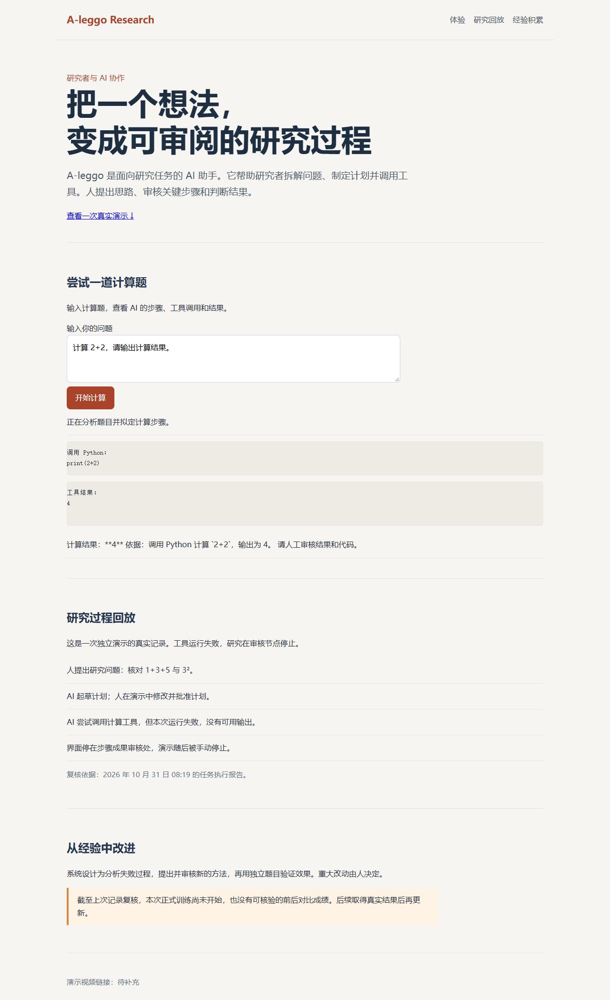

# A-leggo Research

A-leggo Research 是一个研究助手。研究者提出问题和思路，AI 帮忙起草计划、调用工具；研究者审核关键步骤和最终结果。

**[打开线上体验页](https://atomgit.vercel.app)**：输入一道计算题，查看 AI 调用 Python 和给出结果的过程；也可以查看一次真实研究演示的回放。

## 研究怎样进行

提出问题后，AI 起草研究计划；研究者修改并批准。执行时，AI 按步骤调用工具，遇到重要节点暂停，由研究者确认下一步。

## 从经验中改进

系统设计为从失败记录中提出方法，通过审核和独立题目检验效果。根据 2026 年 10 月 31 日 08:19 的记录复核，本次正式训练尚未开始，没有可核验的考试对照成绩。

## 离线查看

下载本仓库后双击 `index.html` 可离线查看回放。该次独立演示的计算工具运行失败，页面按记录展示。

完整研究端源码在 [`source/`](source/)，部署演示的后端在 [`backend/`](backend/)。演示视频链接：待补充。

## 许可

项目按 Apache License 2.0 分发，第三方许可详见 [LICENSE](LICENSE) 和 [第三方说明](THIRD_PARTY_NOTICES.md)。
